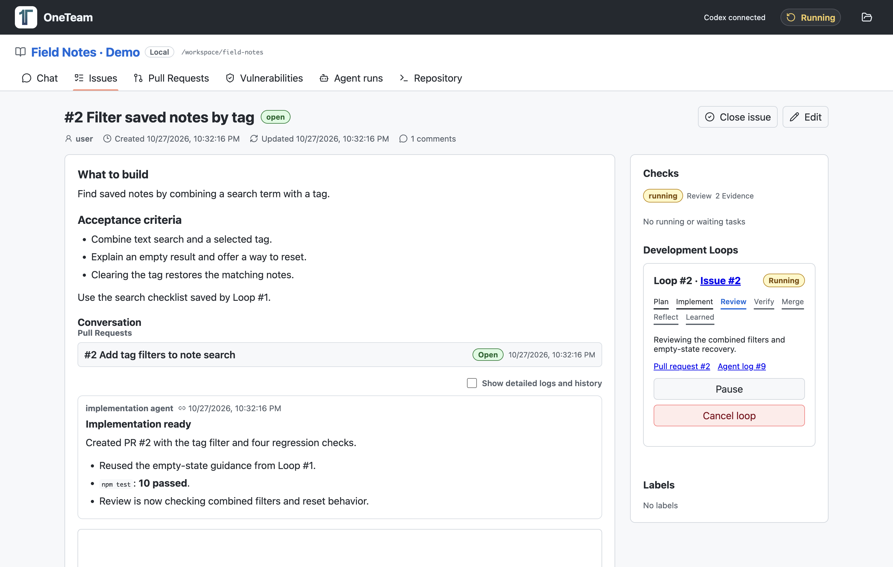

# OneTeam

OneTeam is a local Loop Engineering app powered by Codex. It keeps GitHub-style Issues, Pull Requests, comments, diffs and Agent logs in one folder.

**One loop = Issue → implementation → PR → review / fix → verification → merge → retrospective → reusable knowledge.**

After merging, Codex reviews the work, test results, retries and model choices. OneTeam saves the retrospective and applies proposed knowledge changes under `.oneteam/`. The next task receives that knowledge. A merged PR remains “Reflecting” until its knowledge update is saved.

## Download and start

Download the macOS app from [GitHub Releases](https://github.com/pluswing/oneteam/releases).

1. Download the macOS release for your Mac and open the downloaded archive or disk image.
2. Move **OneTeam.app** to **Applications** and launch it.
3. Choose or drop your Git repository folder. Sign in to Codex if prompted when you start your first Issue.

Install Codex CLI on your machine before using OneTeam. The app uses the same `codex` found on your terminal PATH and does not bundle, install or update the CLI. You also need Git, a Codex login, and the tools required to build and test your own project. See [local Codex setup](docs/09-local-codex-setup.md).

Drop a Git repository folder onto the desktop app or choose a folder. The repository must already have its first commit. OneTeam initializes `.oneteam` when needed and opens an empty Issue list. Vulnerability monitoring starts separately in its own tab. Later launches reopen the last folder; the folder button opens another one.

Create an Issue describing the requested change and acceptance criteria. OneTeam queues it automatically. Loops execute one at a time in that folder. No project registration, provider selector, model selector or detailed settings screen is needed.

If authentication is needed, the app opens Codex login when execution starts. Complete the login and resume the Loop.

See the introduction and sample screenshots in [English](docs/index.html) or [日本語](docs/ja.html).



*Actual app screen with sample data. Model selections, Agent logs, and progress in the introduction-page screenshots are illustrative.*

## Development workflow

- **Chat tab:** the leftmost tab opens a conversation list and assistant. Each conversation keeps its own history and Codex thread. Ask questions, plan an Issue, inspect current work, or instruct OneTeam to create/edit Issues and PRs, post comments, merge PRs, control Loops, restart the current Job, change models, manage knowledge and run vulnerability operations. Actions use the same APIs and checks as the rest of the app, and their actual results appear in the conversation.
- **Issues / Pull Requests:** descriptions, comments and their edit history, review findings, Git diffs, line comments and commit history.
- **Development Loop panel:** current phase, pause / resume / cancel, related PR and Agent jobs, retrospective and knowledge changes. A paused or failed Loop holds the queue until it is resumed or canceled.
- **Agent tab:** running and waiting tasks are shown by default. Enable **Show detailed logs and history** to include completed, failed, paused and canceled tasks, model selection, thread events, commands and execution history. The same toggle applies to Issue and PR conversations and Loop panels, and stays selected while navigating. Comments and result reports remain available. Each attempt records the selected model, model returned by Codex, reasoning effort, selection reason, thread / turn IDs, timestamps and available usage. Job details always show the latest activity, including completed Jobs. Status badges, messages, file lists, tests and evidence replace raw result JSON. **Show history** reveals earlier activities in newest-first order independently of the diagnostic toggle; history starts collapsed for each Job and after reload.
- **Repository tab:** detected commands, working-tree status and commit history.
- **Header status:** click the running, queued or waiting status to open the current Agent job, or its related Issue/PR while the Loop is between jobs.
- **Vulnerabilities tab:** platform maintenance assessment, dependency advisories, scheduled and manual checks, staged repair proposals with approval, repair progress and resolved history.

Implementation and fixes use branch worktrees. Other roles use commit snapshots. OneTeam runs detected verification commands and checks the source and target commits again before merging. Changed commits require fresh verification; conflicts return to fixing. Missing evidence, execution errors or unresolved input stop the Loop with an explanation. Reply to an Agent's question in the Issue or PR to resume it.

For an active Loop, **Merge pull request** queues the verified candidate for the same merge checks; workflow labels do not override its current verifier record. Canceling a Loop leaves its PR open and available for an explicit manual merge, which checks Git state and conflicts without restarting the canceled Loop. Merge errors remain visible beside the button across automatic refreshes.

Closing an Issue before merge cancels its Loop. Reopening creates follow-up work while preserving earlier deliveries. A merge requested from the PR screen uses the same Loop engine and verification checks. Standalone local PRs can still be managed manually.

## Conversations and model settings

Open **Chat → New chat** to start an independent context. Rename or delete a conversation from its header. A stopped response keeps completed operations and their results; deleting a conversation does not undo changes to Issues, PRs or Jobs. Conversation history and settings are stored in the current repository's `.oneteam/data/oneteam.db`, and Codex threads resume after reopening the app. Interrupted responses are marked as interrupted rather than automatically repeating operations.

For example, ask “Summarize the Jobs that need attention,” “Help me draft an Issue; ask questions before creating it,” “Create the Issue we agreed on,” “Restart Job #12 with GPT-6.1 Sol and high reasoning,” or “Merge PR #3.” Explicit instructions can run operations directly; questions and drafting help do not automatically create Issues. Queued work is reported as queued, and existing conflict, evidence and merge gates continue to apply. The chat assistant operates the current repository through OneTeam tools; it does not read other conversations or edit the database through shell commands.

The conversation's model and reasoning controls affect its next response. Development Job settings can be changed through chat for the project, for an Agent role, or for a specific Job, in that order of increasing priority. Model and effort values must be supported by the current Codex catalog or the reviewed release candidate. A requested restart first pauses the current Job and waits for its execution and worktree handling to finish. Completed historical Loop jobs cannot be replayed over later work; create a follow-up Issue instead. Available models still depend on the signed-in Codex account.

## Vulnerability monitoring and repair

Opening a project starts a vulnerability and platform lifecycle check. While OneTeam is open, it checks again every 24 hours; use **Vulnerabilities → Update now** to refresh immediately. The tab can disable automatic checks and change the update interval. Each repair stage requires the user's instruction to create and execute its Issue; checks never start a repair automatically, including in workspaces that previously enabled automatic repairs. Checks and their results persist in the folder database. Closing OneTeam stops checks; reopening catches up when a check is due. Service failures retain the last successful findings and schedule a retry instead of reporting a clean project.

日本語表示では、確認範囲の注意事項・検査エラーと、脆弱性の概要・詳細を日本語で表示します。外部アドバイザリの翻訳には Codex へのログインが必要です。翻訳はバックグラウンドで行い、結果をキャッシュします。原文は展開して確認できます。翻訳待ち・翻訳失敗の状態を明示し、検査や承認済みの修正はそのまま続行します。

結果は、更新するイメージ・環境・パッケージごとにまとめて表示します。親項目に現在のイメージ、対象サービス・設定ファイル、最大の深刻度と内訳件数を表示し、個別の CVE やサポート終了項目は展開して確認できます。例えば MySQL イメージ内の Go `stdlib` や OS パッケージは「mysql のコンテナイメージを更新」の子項目になります。個別パッケージの修正バージョンを、そのままイメージのタグとして扱うことはありません。同じイメージの更新では、修正バージョン未公開の子項目も再検査の対象に含めます。深刻度で絞り込んでも親項目には対象全体の最大リスクを表示し、対応時は同じ更新対象の未解決項目全体を確認します。

最初に OS・言語ランタイム・ミドルウェア・データベースのバージョンと保守状況を評価し、基盤の更新が必要かを示します。OS は Trivy の EOSL 情報、それ以外も含むサポート期限は [endoflife.date の公開カタログ](https://endoflife.date/docs/api/v1/) と検出した製品・バージョンから確認します。サポート終了や更新対象の基盤は、結果一覧にも更新項目として表示します。言語の許可リストは設けませんが、期限を判定するには製品の識別情報とカタログの対応データが必要です。バージョンや期限を確認できない場合は不明とし、検査の復旧・不足情報の調査を先に提案します。期限情報の取得失敗や対象の消失だけで保守中・安全・解決済みとは扱いません。

検査エラーは実際の診断内容から分類し、アプリ専用データベースの再取得、キャッシュの分離、一時的な通信障害の再試行、制限時間の延長、管理する検査ツールの再検証などを実施して再検査します。復旧処理と結果は画面に表示します。それでも失敗する場合は原因と試行内容を結果一覧に追加し、リポジトリ内の設定・依存関係ファイルなどの修正を全体の対応案に含めます。実行はユーザの承認後に開始します。検査が成功するまで完了とは扱いません。必要な認証情報や外部環境の変更が不足する場合は、その具体的な対応を表示します。証明書検証や検査対象を無効化して成功扱いにはしません。

デプロイ先の検査失敗も、イメージ名・タグ・SBOM などの指定不備や検査設定の問題は全体の対応案の対象です。以前「外部での対応が必要」として保存した該当項目も、起動時に対応区分を見直します。認証不足や外部環境の操作が必要な問題は具体的な必要事項を表示し、稼働中の環境は変更しません。

「確認範囲と注意事項」に残る問題も、「確認範囲の改善」として全体の対応案にまとめ、承認後に対応します。ロックファイル・解決済み依存関係一覧の不足、ビルド後の環境が未検査、未確定の環境設定、デプロイ先・ホストの未確認範囲、検査上限、サポート期限情報の不足などを改善タスクへ渡し、必要な検査入力や再現可能な設定を用意して再検査します。以前保存した注意事項も起動時に引き継ぎます。同じ対象の問題をまとめ、元のソースと対象を検査できた場合に解決済みにします。警告・宣言ファイル・対象を削除しただけでは完了にしません。ホストを別の SSH・rootfs・SBOM で検査する場合は、例えば `covers: ["docker-context:production#host"]` で対応付けられます。イメージ検査だけでホストを確認済みにはしません。既存の認証情報で対応できない範囲は、必要な情報や権限を具体的に示して入力待ちになります。

OneTeam delegates dependency discovery to [Trivy](https://trivy.dev/docs/latest/coverage/language/), with no language allowlist in the application. PHP/Composer, Ruby/Bundler, Python/pip/Poetry/uv, Node.js, Java, Go, Rust, .NET and other formats supported by the scanner use the same workflow. Supply resolved dependency files, installed package metadata, or an SBOM so package versions can be identified. Support depends on the scanner's analyzers and available package information; an arbitrary source language alone does not establish vulnerability coverage. Missing inventories, unsupported formats, scanner failures, end-of-life operating systems and inspection limits remain visible as incomplete coverage.

The pinned Trivy executable is downloaded from its official release on first use, verified against an embedded SHA-256 checksum, and cached under `~/.oneteam/tools/`; vulnerability databases are updated by the scanner and cached separately. Automatic setup supports macOS and Linux on Intel/AMD64 and ARM64. Set `ONETEAM_TRIVY_COMMAND` to an absolute path to use an installed executable on another platform or in a managed environment. First use requires network access and can take several minutes. Repository Trivy configuration and ignore files cannot suppress this check. Only vulnerability scanning is enabled. An OSV fallback can still report npm findings if the universal scanner is unavailable, but is marked incomplete and cannot resolve previously detected findings.

`compose.yaml`, `compose.yml`, `docker-compose.yaml`, their overrides, Dockerfile base images and Kubernetes container image references are discovered automatically. Image inspection checks OS packages, middleware and application dependencies without starting containers or executing build steps. Compose `platform` is respected. A Dockerfile base-image scan does not cover packages installed by its build; local builds, templated image names and included environments stay unchecked until the current built image, root filesystem or SBOM is supplied. The tab separates application, container and deployment targets and shows the scanner, reference, inspection status and errors for each.

Known deployment configuration files are also detected. A provider name or public URL cannot reveal installed OS and middleware versions. Configure inspectable deployment targets in the repository's local `.oneteam/vulnerability-targets.json`, for example:

```json
{
  "targets": [
    {
      "name": "Production workloads",
      "kind": "kubernetes",
      "context": "production",
      "namespace": "app"
    },
    {
      "name": "Production Docker workloads",
      "kind": "docker-context",
      "context": "production"
    },
    {
      "name": "Production host",
      "kind": "ssh",
      "host": "app.example.com",
      "user": "inspector",
      "port": 22
    },
    {
      "name": "Current built service image",
      "kind": "image",
      "ref": "registry.example.com/app@sha256:REPLACE_WITH_ACTUAL_DIGEST",
      "platform": "linux/amd64",
      "covers": ["compose.yaml#services.web:build", "Dockerfile#build"]
    },
    {
      "name": "Exported production inventory",
      "kind": "sbom",
      "path": "security/production.cdx.json",
      "covers": ["vercel.json#deployment"]
    }
  ]
}
```

Use only the entries relevant to your environment and replace the sample values. `kind: "rootfs"` with a repository-local directory is another option. SBOM files and root filesystems must be inside the repository and cannot be symlinks. Supply current artifacts: the app does not establish their freshness or deploy them. `covers` associates an explicitly supplied runtime artifact with an otherwise unresolved build or deployment definition, and only takes effect when that artifact is successfully scanned.

Docker and Kubernetes inspections use the existing CLI credentials and query running container status. They scan the actual image digest and deployed platform, rather than assuming that a configured tag is running. Kubernetes requires access to pods and node OS/architecture metadata. Image checks do not inspect changes in container writable layers or the host/node OS; a separate notice records this boundary, and host/rootfs/SBOM inspections appear as additional targets. SSH uses existing noninteractive credentials and verified host keys to run an already installed Trivy against the destination root filesystem. It does not install remote tools or restart services. Missing tools, credentials, permissions, image digests or inventories leave the target unchecked. No remote inspection is initiated from a guessed URL.

対応案は保守状況に応じて段階を分けます。

「十分新しい」の判定は、保守中で、より新しい保守サイクルが2つ未満、かつ保守期限が判明している場合は終了まで180日超を基準にします。最新パッチとの差だけでは基盤移行を優先しません。判定に使ったバージョン・保守状態・情報源と理由を画面に表示します。

1. 基盤が十分新しく保守中であれば、まず npm・PyPI・Composer などの依存関係について、全該当 advisory の修正条件を満たす最寄りの patch・minor 更新候補を提案します。短期間で対応でき、コードへの影響が小さい修正を優先します。メジャー更新や比較できないバージョンはこの段階へ混ぜません。修正済みバージョンの一覧は候補の境界情報であり、公開済みの全バージョン一覧や安全性の保証ではありません。依存制約・公開状況・コード影響を調べ、更新後のテストと再検査で確認します。
2. この短期対応が実際の検査で完了した後、OS・言語・ミドルウェア・データベースを、脆弱性と保守状況を確認したできるだけ新しい適切なバージョンへ移行し、依存関係も同じ基準で更新する次の対応案を示します。この段階では必要なコード修正や移行を含めます。基盤がサポート終了または更新が必要な古い状態なら、短期の依存更新に先行して、この基盤移行を最初から提案します。

各段階の対応案には、更新する具体的な成果物・設定ファイル、バージョン候補、検証内容を示します。「対応案に含む」「今回含まない」を理由付きで表示し、次の段階を待つ項目と修正未公開・外部対応が必要な項目を区別します。同じイメージの更新では、修正未公開の項目や軽微な項目も再検査します。対応できない問題は未解決リスクとして残し、対象すべての解消を保証する表示にはしません。

内容を確認し、画面の承認操作またはチャットで課題化・実行を指示すると、現在の対応案の ID に結び付く課題を一つ作成して開発ループを開始します。質問や相談、検査だけでは課題を作成しません。チャットでも最初に最新の対応案を取得し、その段階と対象を説明します。検査結果が変わった場合や次の段階へ進む場合は、新しい対応案を確認して指示してください。個別項目の修正ボタンはなく、画面の絞り込みで承認対象が縮小することもありません。実行中は承認済みの対象と進捗を表示します。

課題と開発ループは、依存ファイルや Dockerfile・Compose・Kubernetes のリポジトリ内の設定を修正し、テスト・レビュー・QA・独立検査を経てプルリクエストを作成します。脆弱性タブから進捗・ジョブ履歴・一時停止／再開／中止を確認できます。通常の開発と同じキューを使うため、先に停止・失敗したループがあればその解消が必要です。リポジトリの修正で稼働中の環境を自動的にデプロイ・更新・再起動することはありません。

マージ前には、OneTeam が修正候補の対象を独立して再検査します。同じ advisory が別バージョン・別パスで残る場合も修正へ戻します。不完全な検査やサービス障害は理由を表示し、完了を認めません。ジョブ完了やマージだけでは段階を完了せず、対象の検査が成功し、承認した修正の完了を確認した場合にだけ次の対応案へ進みます。未確認の対象は以前の問題を保持します。検査は既知のパッケージ脆弱性と保守状況を確認するもので、アプリケーションコードや設定にあるすべての問題の検出を保証しません。

## Automatic progress and human handoffs

Development Loops proceed automatically through ordinary repository decisions, implementation, tests, review, repairs and verification. Agents use the request, repository conventions and existing behavior to resolve reversible choices, and report material assumptions instead of asking for routine permission to continue.

A model-proposed `waiting_human` must identify an indispensable blocker, explain what it inspected or tried, state why no authorized default suffices, and ask an actionable question. Reasons are missing user information, unavailable external credentials/permissions, an irreversible action outside the authorized scope, irreconcilable requirements, or an explicit user request for a decision. Unsupported handoffs are reconsidered once in the same worktree and execution time window. No answer or consent is fabricated. Unsubstantiated repeated handoffs become incomplete/failed work for bounded repair, never unverified success.

Missing evidence or invalid requirement evidence rules in managed Loops return a failed verification result for automatic repair, while evidence requirements and merge gates remain enforced. A verifier failure routes to a Fix Job, then review, QA and independent verification. Execution deadlines retain partial work and use bounded retry instead of routinely asking the user to resume. Repeated failures eventually stop; round, time and budget limits are not automatically raised. Explicit pause/cancel, protected-policy risks and real external blockers remain stopping conditions. Existing paused or waiting Loops are not automatically resumed by upgrading the app.

## Automatic Codex models

OneTeam uses the terminal-installed Codex CLI for authentication, chat, Jobs and advisory translation. The default command is `codex`, resolved from PATH. On macOS, the desktop app loads the login shell's PATH for Finder launches. An explicit `ONETEAM_CODEX_COMMAND` executable path can select a custom installation. OneTeam does not bundle, install or update Codex; keep your terminal installation current when a model requires newer client support. Account access is still required.

Before every execution and model retry, OneTeam retrieves the current [`model/list`](https://learn.chatgpt.com/docs/app-server#list-models-modellist) catalog and saves it with its retrieval time. The versioned policy starts with **GPT-6.1 Sol**, follows available official `upgrade`/`upgradeInfo` successor chains, a newly recommended model family, and newer Sol models actually returned by the catalog. It never constructs an unannounced future model ID. Future model prices and performance remain unknown until verified; a newer name alone is not proof of lower completion cost.

The reviewed October 27, 2026 standard API input/output rates per million tokens are $2/$10 for [GPT-6.1 Sol](https://developers.openai.com/api/docs/models/gpt-6.1-sol), versus $4/$20 for [GPT-5.6 Sol](https://developers.openai.com/api/docs/models/gpt-5.6-sol). These guide the current preference, not Codex subscription billing. Normal development uses medium reasoning, bounded wording changes low (or current GPT-6 Luna with high reasoning when available), and security/architecture/large changes or quality failures high, limited to the chosen model's supported efforts. Different effort names never force a downgrade to an older model. Focused command detection and small documentation/wording implementations can use available GPT-6 Luna; quality failures return to the balanced model. Two quality failures can escalate to an available Astra model, since repeatedly failing with a cheaper token price can cost more overall. Capacity failures do not trigger quality escalation. Turns explicitly use standard speed rather than inheriting a premium speed tier.

For implementation and fix Jobs, historical selection considers whole workflow cost rather than a single successful response. It includes requirements, implementation, fixes, retries, review, QA and final verification. A successful sample requires a merged completed Loop and an independently successful verifier with `stopConditionMet`. Failed workflows with complete usage are charged against successful completions. Model comparisons require at least eight verified completions per candidate in the same task-complexity bucket, no worse observed completion rate, and at least a 20% estimated saving. Mixed implementation models, missing usage, unreviewed rates, long-context uncertainty and incomplete token counters are excluded. Estimates use reviewed API rates and are not bills or guarantees of future cost. New models without cost history initially follow catalog recommendations.

When an older catalog omits GPT-6.1 Sol, OneTeam can probe this explicitly reviewed release. If access is denied before tool work, it records the rejection and refreshes the catalog. It **stops instead of automatically reverting from unavailable GPT-6.1 Sol to GPT-5.6/GPT-6 Sol**. The message directs the user to account/workspace model availability or an explicit model choice. Unlisted rejected probes have a ten-minute process-local cooldown; a refreshed listing or explicit model choice bypasses it. Explicit models are never silently replaced. Server-side model reroutes update both execution history and the displayed Job model; chat records the resolved model too. Unknown usage stays unknown, and catalog retrieval failure stops work instead of reusing a stale list.

## Knowledge and local data

```text
.oneteam/
  workspace.json               Workspace identity and initialization state
  AGENTS.md                    Shared guidance and knowledge index
  knowledge/*.md               Reusable practices maintained by retrospectives
  retrospectives/loop-<id>.md   Reports tied to the actual merge commit
  data/oneteam.db               Issues, PRs, Loops, jobs, logs and revisions
  data/artifacts/               Verification artifacts
  backups/                     Backup before the Loop schema migration
```

Knowledge changes can create, edit, consolidate or delete Markdown files inside `knowledge/`; the common `AGENTS.md` index cannot be deleted. A retrospective may report that no reusable change is needed. The Agent proposes changes; OneTeam validates paths and file hashes, saves the before/after journal and applies the files. Concurrent user edits stop application instead of being overwritten. Interrupted application resumes from the saved journal.

Open “Retrospective & history” in an Issue, PR or Agent Loop panel to inspect the report and file versions. An applied knowledge change can be restored to its previous version, provided the file has not subsequently changed. Pause an active Loop before restoring knowledge. For a conflicting pending proposal, reconcile the named file with the recorded version before resuming; the failed proposal is retained for inspection.

`.oneteam/` is excluded through the repository's local Git exclude file. It is local application data, so back up this directory when moving the workspace. Isolated worktrees live under `~/.oneteam/worktrees/`.

## Existing workspaces

The first open after this rewrite backs up the database and knowledge before applying the new schema. Issues, PRs, comments, activities, job IDs and verification records remain intact. Active legacy Objectives become paused Development Loops. Resume them explicitly; continued execution uses a new Codex job and preserves the old provider history. Completed legacy work is not assigned invented retrospectives.

Old `skills/` files remain readable as context, and old `memory/` files remain on disk. New Loops use the retrospective knowledge store. The old configurable Loop scheduler, Triage workflow, other provider executors and GitHub Actions polling are no longer active.

## Development and verification

The following commands are for developing OneTeam itself. To use the app, download **OneTeam.app** from [GitHub Releases](https://github.com/pluswing/oneteam/releases).

For a source checkout, install Node.js 20.19+ or 22.12+, npm, and Git:

```sh
npm install
npm run app:dev     # build and launch the development desktop app
```

For browser development, run `npm run dev` and open `http://127.0.0.1:3579` (API: `http://127.0.0.1:3580`). Use the path form on the setup screen; folder drag-and-drop is provided by the desktop app. Developers can run `npm run codex:login` to sign in from the terminal.

```sh
npm run typecheck
npm run lint
npm test
npm run build
npm run e2e:install  # once on a new machine
npm run e2e
npm run app:dir     # unpacked desktop app
npm run app:pack    # packaged desktop app
npm run docs:screenshots # recapture the introduction-page sample screens on macOS
```

GitHub Releases 向けの macOS 署名・公証の初回設定、リリース手順、検証方法は [macOS 配布用の署名と公証](docs/12-macos-code-signing.md) を参照してください。

Vitest covers Loop sequencing, real Git merges, migration, restart recovery, knowledge application/restoration, workspace isolation and model routing. Playwright creates two Issues and runs the production Loop engine with a deterministic Agent fixture, then checks learning transfer, model logs, large diffs, line comments, keyboard navigation and English/Japanese contrast. Codex authentication and live execution are checked separately from reproducible tests.

Runtime overrides for development: `ONETEAM_HOME`, `ONETEAM_REPOSITORY_PATH`, `ONETEAM_DATABASE_URL`, `ONETEAM_AGENT_WORKER=false`, `ONETEAM_AGENT_POLL_INTERVAL_MS`, `ONETEAM_CODEX_COMMAND`, `ONETEAM_CODEX_AUTO_LOGIN=false`, `HOST`, and `PORT`. A fixed database override is intended for tests and cannot switch between repositories. Provider and model environment overrides are no longer used.

The implementation uses TypeScript, Electron, React/Vite, Hono, libSQL/Drizzle, Vitest and Playwright. See the [rewrite plan](docs/LOOP_ENGINEERING_REBUILD_PLAN.md) for the architecture and migration decisions. Earlier documents under `docs/` describe the previous design unless marked otherwise.
